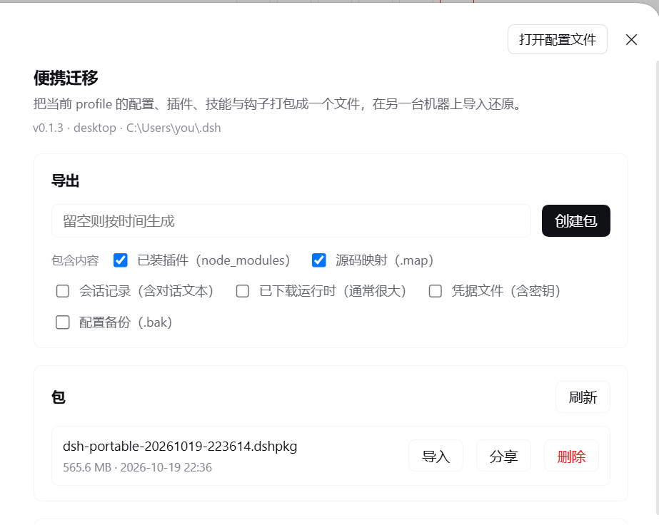
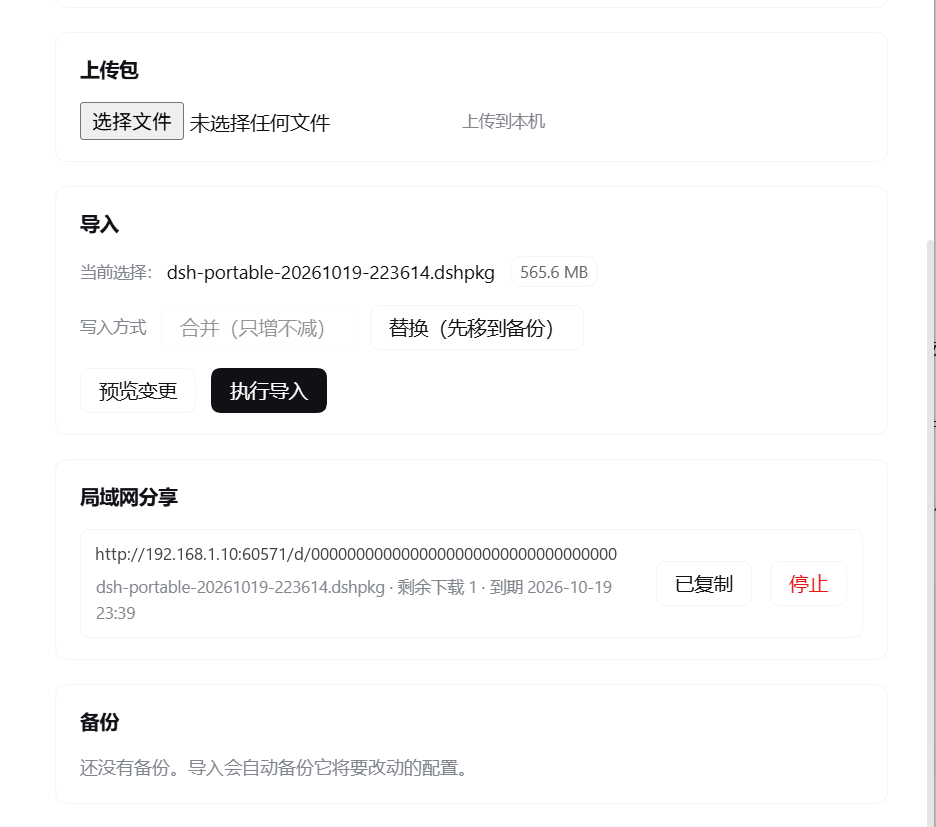

# dsh-portable

**Offline and online export/import for [DeepSeek Harness](https://github.com/deepseek-ai): pack a whole working DSH home into one `.dshpkg` file and restore it on another machine — no network, no `pnpm install`, no manual path fixing.**

[中文说明](README.zh-CN.md) · [CHANGELOG](CHANGELOG.md) · [PUBLISHING](PUBLISHING.md) · [HANDOFF](HANDOFF.md)

---

## Why

Moving a DSH setup between machines is painful for three reasons:

1. A working profile is not one file. It is `profiles/<name>/` plus plugins **with their `node_modules`**, skills, hooks, task boards, storages, `AGENTS.md`, installed runtimes, and session logs.
2. Plugins are installed by pnpm from the network. An air-gapped machine, a locked-down corporate laptop, or a machine behind a dead proxy simply cannot run `dsh plugin add`.
3. Configuration files embed absolute paths (`C:\\Users\\me\\.dsh`, `/home/me/.dsh`) and the profile name, so copying the directory tree produces a DSH that boots with broken plugin paths.

dsh-portable solves all three: it packages a whitelist of roots into a single self-describing archive, refuses to walk outside that whitelist, and on import rewrites the six configuration files that actually contain machine-local paths.

## What goes into a package

| Root | Path | Default |
| --- | --- | --- |
| profile | `profiles/<name>` (config **and** plugin `node_modules`) | always |
| skills | `skills` | always |
| skills-disabled | `skills-disabled` | always |
| hooks | `hooks` | always |
| storages | `storages` | always |
| task boards | task-board / todo-board storage | always |
| browser host | dsh-builtin-browser-host | always |
| agent instructions | `AGENTS.md` | always |
| sessions | session logs | opt-in (`includeSessions`) |
| runtimes | downloaded runtimes | opt-in (`includeRuntimes`) |
| credentials | `.credentials.yaml` | **opt-in, off by default** |
| source maps | `*.map` inside the package | on (`includeSourceMaps`) |
| backups | `*.bak-*` next to config files | off (`includeBackups`) |

Anything not listed is never collected — there is no recursive "copy the whole home directory" step anywhere in the code.

## Install

```bash
dsh plugin --profile desktop add dsh-portable
```

The plugin has to be registered in the profile's own `package.json` — under `dependencies` **and** `dsh.profile.bundles`. Copying the package directory into `profiles/<profile>/node_modules` by hand looks like it works, until that profile runs `npm install` again: npm treats an undeclared package as extraneous and deletes it, and from then on the panel still renders its cards while every request answers `404`. `dsh plugin add` (or `npm install dsh-portable` inside the profile) writes both halves.

Then open **DSH settings → Portable Migration** (便携迁移). The panel is registered at `settings.section` with order 70, and is bilingual (zh/en) automatically.

Nothing is written to the DSH home until you press a button.

## Using the panel

Six cards:

1. **Export** — pick which optional roots to include, name the file, press Export. Packing runs in a worker thread; the progress bar streams entry counts, and a 20 MB package over ~14 000 entries takes about 3 seconds.
2. **Packages** — every `.dshpkg` under `<DSH_HOME>/dsh-portable/exports`, with size, entry count, manifest summary, and buttons: Download / Import / Share / Delete (delete asks for confirmation). *Download* streams the package to the browser so it can be saved to disk and carried to another machine on a USB stick — the LAN share is only reachable while both machines are on the same network.
3. **Upload** — drag or pick a `.dshpkg` and it is streamed to disk (`.part` then rename), so a 2 GB package never sits in memory.
4. **Import** — choose merge or replace, press *Preview* first (zero writes), then *Import* (explicit confirmation). The result lists applied items, rewritten files, backup location and warnings.
5. **LAN share** — publish a package as a one-shot download link (`http://<lan-ip>:<port>/d/<token>`). Defaults: **1 download, 60 minutes**, Range/HEAD supported, 410 on expiry or exhaustion. No relay, no cloud, no account.
6. **Backups** — the automatic pre-install backups (`<DSH_HOME>/portable-backups/<stamp>`), newest 5 kept.

## Screenshots

Taken from the DSH settings panel. The DSH home path and the LAN share link in these images are placeholders.





## HTTP API

Base: `/dsh-portable/api`. All responses are JSON except the download route and the uploaded-file streaming route. Authentication reuses the host's `connection.requestRejection` fence (cookie + trusted origin), and falls back to a loopback-only check when that service is absent.

| Method | Path | Purpose |
| --- | --- | --- |
| GET | `/status` | host info, package counts, active job, share server state |
| GET | `/profiles` | profiles present in this DSH home |
| GET | `/jobs` | recent jobs (export / preview / import) |
| GET | `/jobs/detail?id=` | one job with live progress |
| POST | `/jobs/cancel` | cancel a running job |
| POST | `/export` | start an export |
| GET | `/artifacts` | packages available for import |
| GET | `/artifacts/meta?id=` | manifest of one package |
| GET | `/artifacts/download?id=` | stream a package to the browser as an attachment (save it to disk) |
| POST | `/artifacts/delete` | delete a package (confirmed in the UI) |
| PUT | `/upload/<name>` | stream an uploaded package to disk |
| POST | `/import/preview` | two-phase install, phase 1 (zero writes) |
| POST | `/import` | two-phase install, phase 2 (`confirm:true` required) |
| GET | `/backups` | automatic pre-install backups |
| POST | `/share` | mint a one-shot LAN download link |
| GET | `/share` | list live links |
| POST | `/share/remove` | revoke a link |

**Everywhere a package is named, the API takes an `artifactId` such as `exports:machine-20261018.dshpkg`, never a filesystem path.** `/`, `\\`, `..` and control characters are rejected, so neither the model nor a web page can use this plugin to read or write an arbitrary file.

## Model tools

Registered on the host tools service (silently skipped if the service is absent):

| Tool | Behaviour |
| --- | --- |
| `portable_export` | package the current profile; returns id, size, entry count, per-root breakdown |
| `portable_inspect` | read a package manifest without importing |
| `portable_import` | **without `confirm:true` it is a dry run**; with it, performs the two-phase install |
| `portable_share` | mint a one-shot LAN link (1 download, 60 min) |

## CLI bootstrap (target machine without DSH)

```bash
# Windows
powershell -ExecutionPolicy Bypass -File bootstrap\install.ps1 preview .\machine.dshpkg
powershell -ExecutionPolicy Bypass -File bootstrap\install.ps1 install .\machine.dshpkg --yes

# macOS / Linux
sh bootstrap/install.sh preview ./machine.dshpkg
sh bootstrap/install.sh install ./machine.dshpkg --yes
```

Flags: `--home <dir>` (default `$DSH_HOME` or `~/.dsh`), `--profile <name>`, `--mode merge|replace`, `--keep <n>`, `--yes`. Exit codes: `0` success, `1` failure, `2` usage error. Without `--yes` on a non-TTY it refuses to write.

## Package format

`.dshpkg` is a gzipped tar. The manifest is the **first** entry:

```text
.dsh-portable/manifest.json
profiles/desktop/...
skills/...
hooks/hooks.json
...
```

```json
{
  "format": "dsh-portable/1",
  "createdAt": "2026-10-18T02:11:03.000Z",
  "tool": { "name": "dsh-portable", "version": "0.1.0" },
  "source": {
    "hostname": "WORKSTATION",
    "platform": "win32",
    "arch": "x64",
    "node": "v22.23.2",
    "dshHome": "C:\\Users\\me\\.dsh",
    "profile": "desktop"
  },
  "options": { "includeNodeModules": true, "includeSessions": false },
  "stats": { "entries": 13774, "files": 13482, "dirs": 292, "links": 0, "bytes": 20664511 },
  "roots": [{ "id": "skillsDisabled", "logical": "skills-disabled", "files": 13193, "bytes": 44615569 }]
}
```

Because it is a plain tar, `tar -xzf machine.dshpkg` works anywhere — you can inspect a package on a machine that has never heard of DSH. Long paths use PAX extended headers; the reader understands them incrementally, including PAX bodies that straddle chunk boundaries.

## Import pipeline

```text
preview:  read manifest ──► per-top counts + existsOnTarget ──► report (zero writes)
install:  extract to <home>/portable-staging/<stamp>
          ──► rename profile dir if the target profile name differs
          ──► rewrite local paths in the 6 config files
          ──► back up those 6 files to <home>/portable-backups/<stamp>
          ──► apply each top-level item (merge: add/overwrite; replace: move aside first)
          ──► prune old backups ──► delete staging
```

Path rewriting is deliberately narrow: only `profiles/<p>/cordis.patch.yml`, `cordis.yml`, `package.json`, `pnpm-workspace.yaml`, `hooks/hooks.json`, `hooks/settings.json`. Plugin package contents are **not** rewritten, so third-party integrity checks and source maps stay intact.

## Safety model

- **Whitelist collection.** No recursive home-directory walk exists.
- **Artifact ids, never paths.** See above.
- **Import needs confirmation.** The route returns `400 CONFIRM_REQUIRED` without `confirm:true`; the model tool defaults to dry run.
- **Extraction guards.** 200 000 entries, 2 GB single file, 8 GB total, compression ratio 200 (only after 64 MB of output), `wx` flags (no overwrite), `safeJoin` against `..`, symlinks rejected when absolute or escaping.
- **Backups before writes.** The six configuration files are copied aside before anything is applied; `replace` mode moves whole directories into `portable-backups/<stamp>/replaced/` rather than deleting them.
- **Credentials are opt-in.** `.credentials.yaml` is skipped unless explicitly requested, and the panel labels the risk on the checkbox. Export is a purely local operation; nothing is uploaded.
- **Share links are narrow.** One download, 60 minutes, single file, token-gated, 410 afterwards. No directory listing, no relay.

## Development

```bash
npm test          # 43 tests: tar, archive, installer, jobs, routes, share, inspect
npm run check     # syntax check + import smoke test
npm run sync      # copy this package into a profile's node_modules for live testing
npm run verify    # release gate: version consistency, files manifest, tests
```

The plugin has **no build step**: `index.js` (host), `lib/client.js` (browser bundle, plain `React.createElement`) and `lib/*.mjs` are shipped as-is. That is a deliberate constraint — a DSH plugin must load on a host whose package versions are unknown, so the client half depends on nothing but `react` and `--dsw-alias-*` CSS variables.

## Compatibility

- DSH `>= 0.1.7-rc.2`
- Node `^22.15.0 || >= 24.0.0`
- Windows, macOS, Linux (long paths handled through the `\\?\` prefix on Windows)

## Limitations

- Session logs are opt-in because they contain conversation content.
- A package is a tar: it is not encrypted and not signed. Put it on encrypted media if it contains credentials.
- Import merges or replaces whole top-level roots; there is no per-file selector in v0.1.x.
- Symlinks that point outside the DSH home are packaged as links but will fail to be recreated on Windows without developer mode; that failure is a warning, not an abort.

## License

MIT — see [LICENSE](LICENSE).
